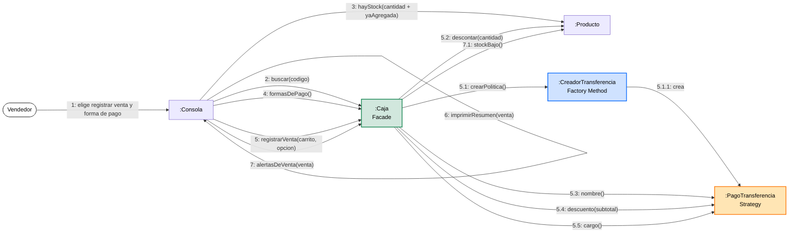

# Diagrama de comunicación — registrar una venta

Mismo escenario que el diagrama de secuencia: venta pagada por **transferencia** en la versión 1 (`v1/main.cpp`). Los mensajes van numerados (1, 5, 5.1, 5.1.1…) según su orden y su anidamiento. Los patrones se identifican por color: 🟩 Facade (`Caja`) · 🟦 Factory Method (`CreadorTransferencia`) · 🟧 Strategy (`PagoTransferencia`).

