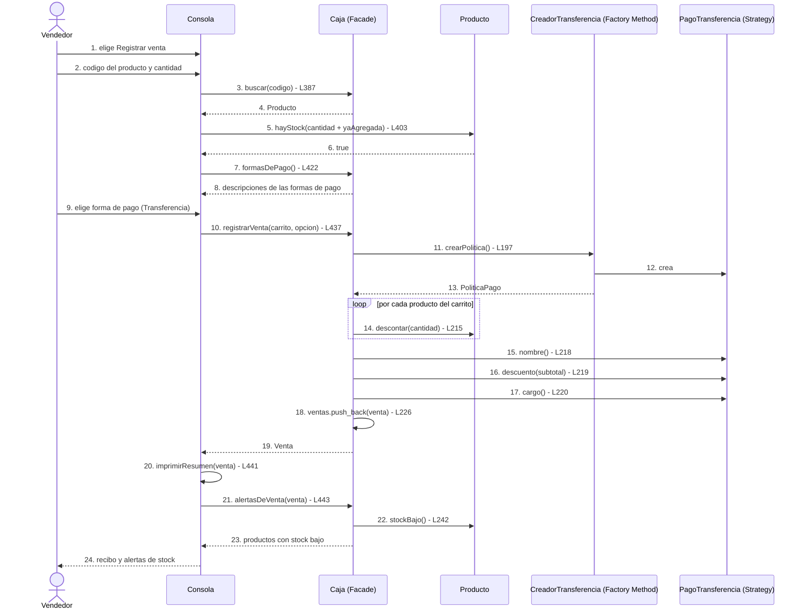

# Diagrama de secuencia — registrar una venta

Escenario: el vendedor registra una venta pagada por **transferencia**, con la versión 1 (`v1/main.cpp`). Cada mensaje indica la línea del código que lo produce (por ejemplo `L437`). Los patrones aparecen entre paréntesis junto a su clase: `Caja` (Facade), `CreadorTransferencia` (Factory Method) y `PagoTransferencia` (Strategy).

