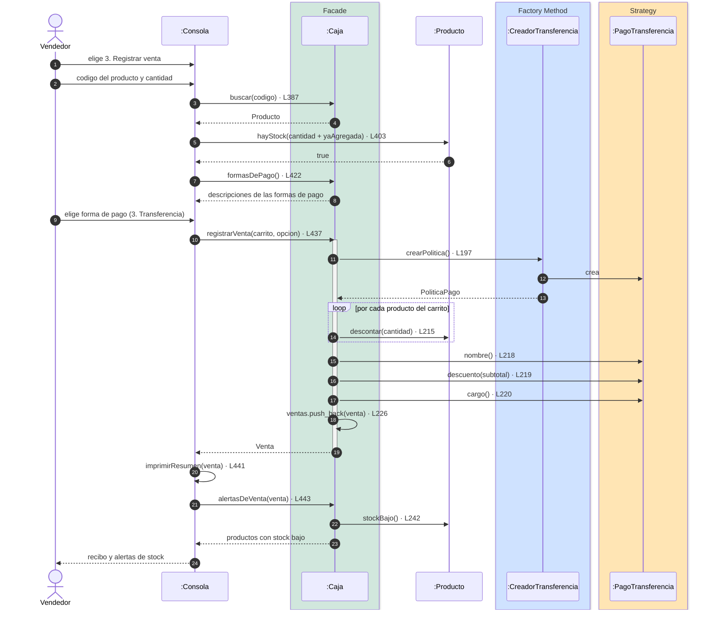

# Diagrama de secuencia — registrar una venta

Escenario: el vendedor registra una venta pagada por **transferencia**, con la versión 1 (`v1/main.cpp`). Cada mensaje indica la línea del código que lo produce. Los patrones se identifican por color: 🟩 Facade (`Caja`) · 🟦 Factory Method (`CreadorTransferencia`) · 🟧 Strategy (`PagoTransferencia`).

