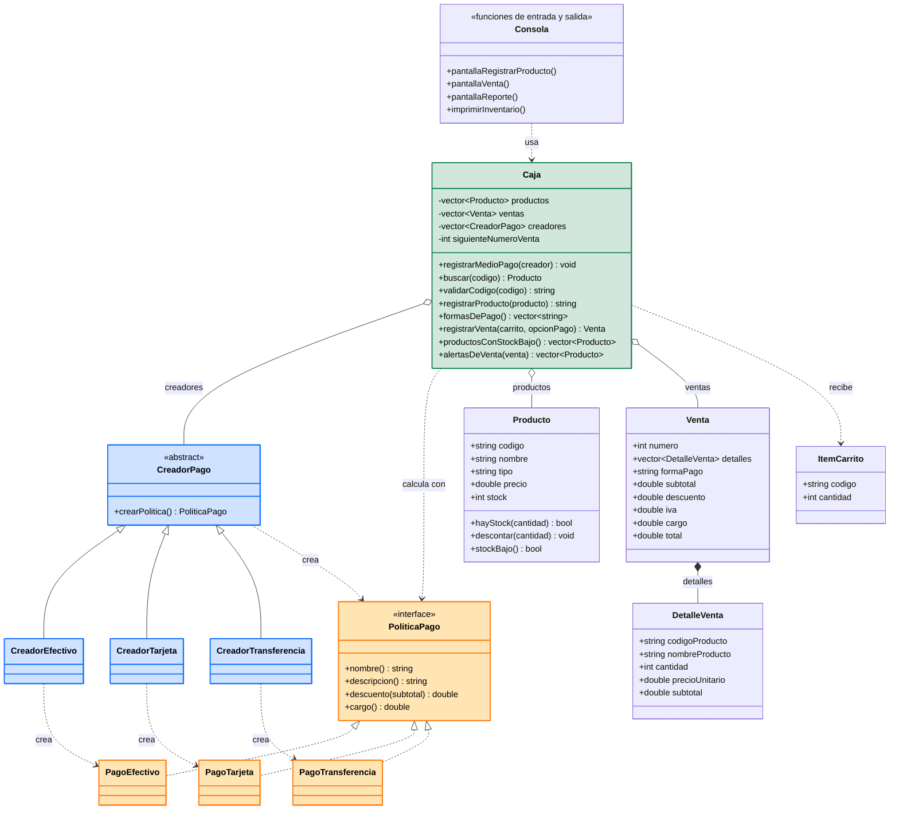

# Justificación de los patrones — versión 1

Patrones aplicados en `v1/main.cpp` para rediseñar **Se Te Cayó el Calzón**, uno por cada grupo:

| Grupo | Patrón | Clases | Líneas en `v1/main.cpp` | Antipatrones de la V0 que corrige (ver `02_antipatrones.md`) |
|---|---|---|---|---|
| Creacional | Factory Method | `CreadorPago`, `CreadorEfectivo`, `CreadorTarjeta`, `CreadorTransferencia` | 113-143 | 3 y 8 |
| Estructural | Facade | `Caja` | 146-259 | 1 y 6 |
| Comportamiento | Strategy | `PoliticaPago`, `PagoEfectivo`, `PagoTarjeta`, `PagoTransferencia` | 65-110 | 3, 4, 5 y 9 |

> Combinación: **Factory Method + Facade + Strategy**. Debe confirmarse con el docente que ningún otro equipo la haya registrado antes (regla 3.1 de la guía).

## Diagrama de clases de la versión 1

Cada patrón se identifica con un color: 🟦 **azul** = Factory Method (creacional) · 🟩 **verde** = Facade (estructural) · 🟧 **naranja** = Strategy (comportamiento). Las clases sin color son el modelo y la consola.



Imagen del mismo diagrama: `docs/uml/clases_v1.png`.

## 1. Strategy (comportamiento): formas de pago intercambiables

**Problema en la V0.** El descuento y el cargo se calculaban con `if / else if` según el número de la forma de pago (`v0/tienda_v0.cpp:311-321`). El 3 % estaba escrito dos veces (líneas 313 y 315), el `800` aparecía suelto (línea 320) y el cargo se perdía al guardar la venta (antipatrón 9).

**Solución en la V1.** La interfaz `PoliticaPago` (líneas 73-80) define `nombre()`, `descripcion()`, `descuento(subtotal)` y `cargo()`. Cada forma de pago es una clase: `PagoEfectivo`, `PagoTarjeta` y `PagoTransferencia` (líneas 82-110). El 3 % y los $800 son constantes con nombre (líneas 70-71) y se usan en un solo lugar. `Caja.registrarVenta` solo llama a `politica->descuento()` y `politica->cargo()` (líneas 218-220), sin preguntar de qué forma de pago se trata. El cargo ahora se guarda en `Venta.cargo` (línea 55).

**Qué pasa si se retira.** Vuelven los `if / else if` dentro de `registrarVenta`, el descuento duplicado y los números mágicos; agregar una forma de pago exige modificar el cálculo de la venta.

## 2. Factory Method (creacional): crear la política de pago

**Problema en la V0.** La opción del menú (1, 2 o 3) se traducía a una forma de pago con condicionales en tres lugares: el menú (líneas 192-197), el nombre (199-208) y el cálculo (311-321). Además, el límite `opcionPago > 3` estaba escrito a mano (líneas 304 y 307).

**Solución en la V1.** `CreadorPago` (líneas 118-122) declara el método fábrica `crearPolitica()`; cada creador concreto (`CreadorEfectivo`, `CreadorTarjeta`, `CreadorTransferencia`, líneas 124-143) decide qué política instanciar. `Caja` guarda los creadores en un vector y usa la opción elegida como posición (línea 197), de modo que no hay condicionales. El menú también se genera desde los creadores (`formasDePago`, líneas 186-192), por lo que el límite de opciones deja de estar escrito a mano.

**Qué pasa si se retira.** La instanciación de `PagoEfectivo`, `PagoTarjeta` y `PagoTransferencia` volvería a hacerse con condicionales dentro del flujo de venta, y el menú volvería a escribirse a mano.

## 3. Facade (estructural): la clase `Caja`

**Problema en la V0.** `registrarVenta()` tenía 149 líneas (`v0/tienda_v0.cpp:210-358`): pedía datos, validaba, calculaba, descontaba stock e imprimía. Además `inventario`, `ventas` y `siguienteNumeroVenta` eran variables globales (líneas 42-44).

**Solución en la V1.** `Caja` (líneas 146-259) oculta el proceso de venta detrás de un solo método, `registrarVenta(carrito, opcionPago)` (líneas 195-228): pide la política al creador, arma el detalle, calcula subtotal, descuento, IVA, cargo y total, descuenta el stock y guarda la venta. Los datos pasan a ser atributos privados de `Caja`. La consola (`pantallaVenta`, línea 370) solo recoge datos, llama a `Caja` y muestra el resultado; no contiene ninguna regla de negocio.

**Qué pasa si se retira.** La coordinación vuelve a la consola, reaparece la función larga que mezcla `cin`/`cout` con reglas de negocio y el estado vuelve a quedar suelto.

## 4. Por qué los tres se integran en el flujo «registrar una venta»

Se cumple la regla de integración de la guía (3.1):

1. **Comparten abstracciones.** `CreadorPago` produce objetos `PoliticaPago`; `Caja` solo conoce esas dos interfaces, nunca las clases concretas.
2. **El objeto que produce uno lo usa otro.** Factory Method crea la política → Strategy calcula descuento y cargo → Facade (`Caja`) coordina ambas dentro del mismo método de venta.
3. **Al retirar cualquiera, reaparecen condicionales o código duplicado.**

| Si se retira… | Reaparece |
|---|---|
| Strategy | Condicionales y descuento duplicado en el cálculo del cobro |
| Factory Method | Condicionales para decidir qué política usar y menú escrito a mano |
| Facade | Función larga que mezcla consola y reglas de negocio |

Secuencia del flujo en la V1:

`pantallaVenta` → `Caja.registrarVenta(carrito, opcion)` → `CreadorPago.crearPolitica()` → `PoliticaPago.descuento()` y `PoliticaPago.cargo()` → se descuenta el stock y se guarda la venta → `Caja.alertasDeVenta(venta)`.

## 5. Antipatrones de la V0 y su estado en la V1

| # | Antipatrón (V0) | Estado en la V1 |
|---|---|---|
| 1 | Función que lo hace todo | Corregido: `Caja.registrarVenta` tiene 34 líneas y la consola quedó separada (Facade) |
| 2 | Estado global | Mejorado: los datos son atributos privados de `Caja`; no se aplicó Singleton |
| 3 | Condicionales por forma de pago | Corregido (Strategy + Factory Method) |
| 4 | Código duplicado | Corregido: descuento en una constante, alerta con una sola regla (`Producto.stockBajo`), resumen de venta con una sola función (`imprimirResumen`) |
| 5 | Números mágicos | Corregido: `DESCUENTO_ELECTRONICO`, `CARGO_TRANSFERENCIA` y `STOCK_MINIMO` con nombre |
| 6 | Mezcla de interfaz y lógica | Corregido (Facade) |
| 7 | Modelo anémico | Mejorado: `Producto` tiene comportamiento (`hayStock`, `descontar`, `stockBajo`); `Venta` y `DetalleVenta` siguen siendo datos |
| 8 | Obsesión por los primitivos | Mejorado: la forma de pago es una clase; `tipo` sigue siendo `string` |
| 9 | Cargo que se pierde (error) | Corregido: `Venta.cargo` se guarda y el reporte lo muestra |
| 10 | Valor de retorno `-1` | Corregido: `buscar` devuelve un puntero nulo si no encuentra el producto |
| 11 | Comparación frágil de texto | Corregido: `esFin` ignora mayúsculas |

## 6. Diferencias de comportamiento respecto a la V0

Con las mismas entradas, la V1 produce los mismos totales que la V0. Las únicas diferencias visibles son:

- El menú dice `V1` en lugar de `V0`.
- El cargo de la transferencia se muestra como `Cargo adicional (Transferencia)` y ahora también aparece en el reporte de ventas.
- El reporte usa las mismas etiquetas que el recibo (`IVA (19%)` y `TOTAL`).
- Las formas de pago del menú se generan desde los creadores registrados.

## 7. Patrones considerados y descartados

| Patrón | Motivo |
|---|---|
| Observer (alerta de stock) | La regla del stock mínimo ya quedó en un solo lugar (`Producto.stockBajo`); no justifica un patrón adicional. |
| Decorator (IVA y descuentos) | Se superpone con Strategy: cada forma de pago aplica una sola regla y no hay descuentos acumulables. |
| Singleton (inventario único) | Reintroduce estado global; la guía lo señala como posible antipatrón. |
| Builder (armar la venta) | `Caja.registrarVenta` ya arma la venta en un solo método corto. |

## 8. Cambio en vivo previsto para la sustentación

Agregar una nueva forma de pago, por ejemplo contraentrega con 2 % de descuento, se resuelve con dos clases nuevas y una línea en `main`, sin modificar `Caja`, las políticas existentes ni la consola:

```cpp
class PagoContraentrega : public PoliticaPago {
public:
    string nombre() const override { return "Contraentrega"; }
    string descripcion() const override { return "Contraentrega (2% de descuento)"; }
    double descuento(double subtotal) const override { return subtotal * 0.02; }
    double cargo() const override { return 0; }
};

class CreadorContraentrega : public CreadorPago {
public:
    unique_ptr<PoliticaPago> crearPolitica() const override {
        return make_unique<PagoContraentrega>();
    }
};

// en main():
caja.registrarMedioPago(make_unique<CreadorContraentrega>());
```
